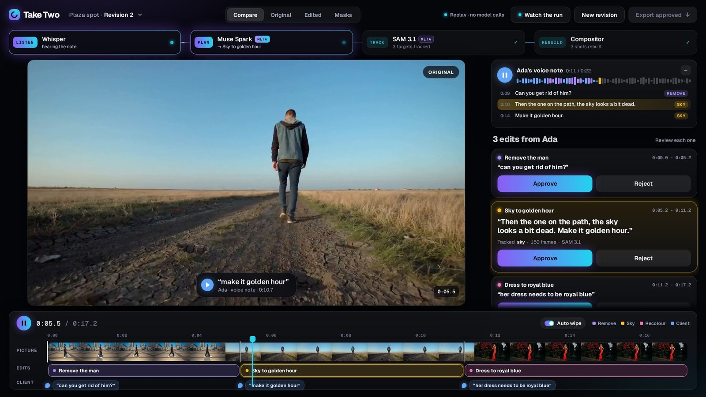
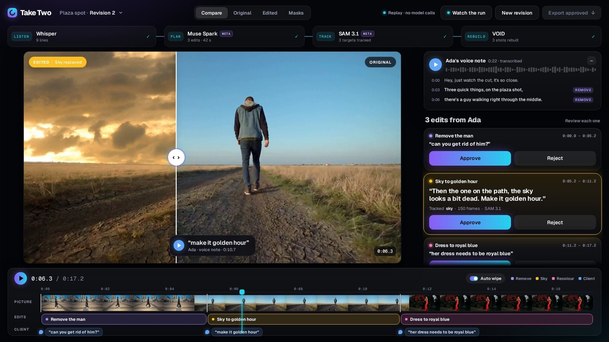
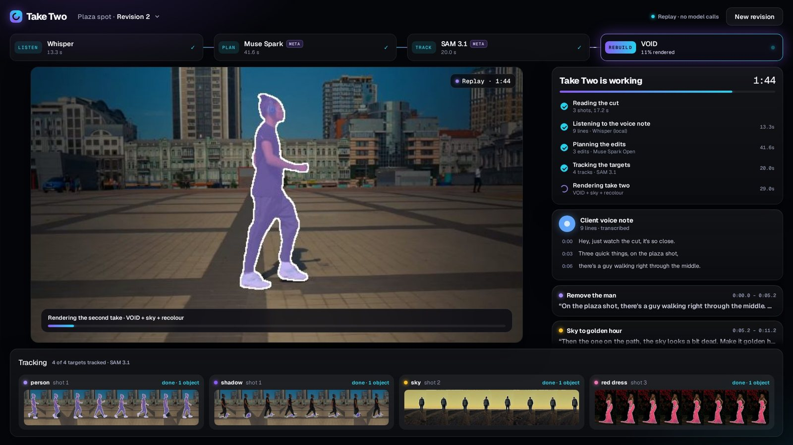
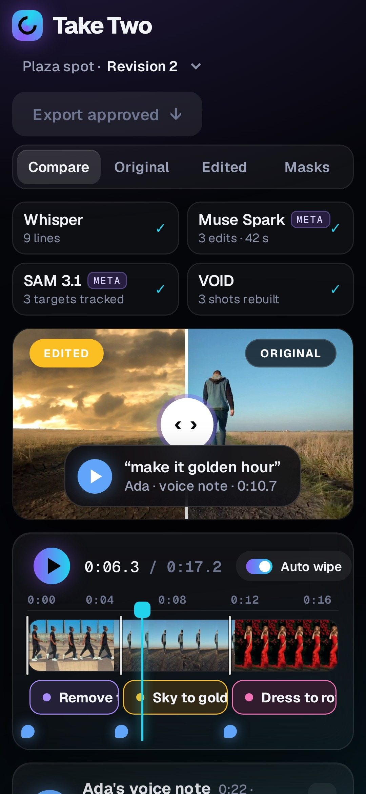

# Take Two

**Client notes that edit themselves.**

A client sends a voice note: *"at like twelve seconds my bank app is showing, blur it. And when I turn, put LAGOS 2026 behind me."*
Take Two listens, finds each moment, tracks the right object frame by frame, and gives the editor a proposed edit they can approve. Then it exports a timeline the editor can open in their NLE.

Built for the Meta Global AI Developer Hackathon (Indie track · Build for Your World).



| The edit, wiped against the original | SAM 3.1 tracking each target, live | At 360 px on a phone |
|---|---|---|
|  |  |  |

The showcase: one client voice note asks for three fixes. Muse Spark Open plans them against the cut's own timeline (and adds "his shadow" to the removal on its own), SAM 3.1 tracks every target on every frame, and Take Two renders each as a proposed edit: a man walking through a plaza removed with his shadow, a flat sky turned golden hour, a red dress recoloured to royal blue while the red roses stay red. Nobody draws a mask. The plan Muse Spark Open returned is in [`docs/showcase/`](docs/showcase/).

## How it works
```
the cut + the client's voice note (uploaded in the editor)
   ├─ ingest: 720p proxy, shot detection, frame-exact shot segments, timecoded keyframes
   ├─ transcript: local Whisper (Muse Voice Transcribe slots in through meta_client)
   └─ Muse Spark Open (Meta open weights; planner, tool calls) ──► timecoded edit ops, each quoting the client
        ├─ SAM 3.1 (Meta open weights; video, noun-phrase concept) per shot × target ──► per-frame masks, stable ids
        └─ render: matte hygiene → privacy mosaic · title behind the subject · make-him-pop grade
editor: live progress (masks paint in as they decode) → before/after diff → approve / reject → MP4 + FCP7 XML
```
Every stage streams to the editor over server-sent events and caches its output, so a failed run resumes
at the stage that broke ("Retry from here"). The replay project needs no model calls at all.

## Architecture
| Layer | What it does | Where |
|---|---|---|
| Ingest | 720p proxy, shot detection, frame-exact shot segments, timecoded keyframes, 16 kHz WAV | `backend/app/ingest.py` |
| Transcript | local Whisper (faster-whisper "small"), timestamped lines | `backend/app/live.py` |
| Planner | Muse Spark Open (Meta open weights) with tool calling: transcript + keyframes → timecoded ops (`remove`, `sky`, `recolour`, `blur`, `title_behind`, `spotlight`, `ask`), each tied to the client's words | `backend/app/planner.py` |
| Masks | SAM 3.1 (Meta open weights) video segmentation per shot × target, run in parallel; RLE decode to per-frame mattes with stable object ids | `backend/app/sam_fal.py`, `backend/samdecode/` |
| Looks | matte hygiene (guided filter), frosted privacy mosaic that keeps fingers sharp, world-locked title behind the subject with contact shadow and light wrap, make-him-pop grade with rim light | `backend/app/looks.py`, `backend/app/title_fx.py` |
| Render | per-shot frame render → joined cut; export renders only approved ops from cached mattes | `backend/app/pipeline.py` |
| Live run | staged job with server-sent events, per-stage cache, resume-on-retry, survives an API restart | `backend/app/live.py`, `backend/app/main.py` |
| NLE export | FCP7 XML (xmeml v4): V1 client cut, V2 Take Two edits, markers with the client's words | `backend/app/fcpxml.py` |
| Editor | React + Vite + TypeScript, "Signal" look (dark glass, Geist): a model rail that lights up the model working right now (Whisper → Muse Spark → SAM 3.1 → VOID / compositor), wipe-reveal player (EDITED left, ORIGINAL right, always labelled; auto wipe inside each edit or drag it), the client's voice note with a live transcript tied to the edit each line asked for, approve/reject cards, picture/edits/client timeline, SAM 3.1 mask view, export popover, live progress view | `frontend/src/` |

The models are reached through OpenAI-compatible (planner) and queue (SAM) HTTP APIs configured in `backend/.env`, so the same code runs against any host serving the open weights.

## Built during the hackathon (Oct 26 – Nov 4, 2026)
Everything in this repository was written during the event window. The first commit is dated Oct 26, 2026.
<!-- keep this list current: it is what judges use to see what is new -->
- [x] Repo scaffold: FastAPI backend, React + Vite + TypeScript frontend
- [x] Ingest: 720p proxy, keyframes, 16 kHz WAV
- [x] Voice-note notes: timestamped transcript (local Whisper today; Muse Voice Transcribe slots in through `meta_client`)
- [x] Planner on Meta open weights (Muse Spark Open, tool calling → timecoded op JSON, grounded on keyframes)
- [x] SAM 3.1 video masks (open weights) with stable object ids; RLE loader + matte refine
- [x] Ops on real mattes: frosted privacy mosaic (fingers stay sharp) · title behind the subject (world-locked) · make-him-pop grade (subject +0.85 stop, background −1.1 stop, rim + light wrap)
- [x] Editor: split-wipe diff player, colour-coded mask overlay, approve/reject per edit, timeline of edit spans
- [x] Export: MP4 of the approved edits only (SAM mattes cached, no re-segmenting)
- [x] Live route: upload a cut + a voice note in the editor → transcript → plan → SAM 3.1 masks → render, with a live progress view (stages, transcript and edit cards streaming in, masks painting in per shot), clean errors and resume-on-retry
- [x] FCP7 XML export: V1 the client cut, V2 the approved edits cut to their spans, sequence markers carrying the client's words (`GET /projects/{id}/export.xml`)
- [x] Editor redesign ("Daylight"): white tiles on warm grey, Inter Tight + Inter, colour only for meaning (client blue, one hue per kind of edit). Play the client's voice note and the editor follows it: each line lights up the edit it asked for, the player jumps to that shot and wipes the edit in
- [x] Editor redesign v2 ("Signal", Oct 31): dark glass + neon, Geist and Geist Mono. A model rail across the top lights up the model working on each step (Listen · Whisper, Plan · Muse Spark, Track · SAM 3.1, Rebuild · VOID or the compositor), in the live progress view and in the editor (the voice note lights the planner; playback inside an edit lights SAM 3.1 and the model that rebuilt the shot). Designed down to a 360 px phone
- [x] Planner tools `propose_remove`, `propose_sky`, `propose_recolour`. Muse Spark Open now plans the showcase from the voice note itself: 3 edits on the right shots, "his shadow" included, in 41.6 s (`dev/run_planner_wow.py`, output in `docs/showcase/`)
- [x] "Watch the run": the showcase's recorded run (real compute times; fal queue waits not shown) replays through the same live progress view, sped up and labelled as a replay
- [x] Showcase project: three edits that normally take hours of roto: remove a man walking through a plaza (and his shadow) with SAM 3.1 masks + VOID video inpainting; a flat sky to golden hour on a SAM 3.1 sky matte; a red dress to royal blue with the roses untouched. New op kinds `remove`, `sky`, `recolour`; export joins the approved edited shots

## Run locally
```bash
# backend
cd backend && python3 -m venv .venv && . .venv/bin/activate
pip install -r requirements.txt
cp .env.example .env   # add PLANNER_API_KEY (Fireworks) and FAL_KEY (fal) for the live route
uvicorn app.main:app --port 8000

# frontend
cd frontend && npm install && npm run dev
```

Live route: open the editor, press **+ New revision**, drop the cut (up to 60 s) and the voice note, press **Run Take Two**.

Showcase project (opens by default; built from the rendered shots, their SAM 3.1 answers and the client's voice note). The media is too big for git, so it ships as a release asset: download [`showcase_media.zip`](https://github.com/zxreigns/take-two/releases/download/showcase-v1/showcase_media.zip) (about 28 MB) and unzip it next to the repo.
```bash
unzip showcase_media.zip -d showcase_media     # removal_v2/ sky/ recolour/ masks/ voice/ planner_ops_wow.json
cd backend && python -m app.wow --wow ../showcase_media
python -m app.wow --wow ../showcase_media --run      # planner cards + the recorded run ("Watch the run", or /?run=replay)
# http://localhost:5173/   ·   the Lagos replay below opens at /?project=demo
```

Replay project (no model calls; a finished live run frozen with its media, plan, transcript and mattes):
```bash
cd backend && python -m app.demo --from-live <project id>
python -m app.wow --thumbs-for demo   # timeline thumbnails
# http://localhost:5173/?project=demo
```

## Media credits
Demo footage is free stock from Mixkit, used under the Mixkit Stock Video Free License:
- "Man texting on WhatsApp" (mixkit.co #41173), a 4 s section cropped to 16:9 for shot 1
- "Man walking among traffic in the city" (mixkit.co #101)
- "A man being followed walking in a city" (mixkit.co #134)

- Showcase: "Young man walking listening to music from his headphones" (#4855), "Young man walking in a rural path" (#23818), "Sunbeams through the clouds in the sunset" (#7444, sky plate), "Blonde girl in a red dress" (#47773)

Showcase removal uses VOID (Netflix, video object and interaction deletion; weights Apache-2.0, served on fal). VOID is fine-tuned from CogVideoX-Fun-V1.5-5b-InP, whose 5B transformer is under the CogVideoX License (free for research; commercial use needs a free registration with the licensor). Take Two calls VOID through fal's hosted endpoint.

Launch film music: "Uplifting Bass" by Lily J (mixkit.co #726), Mixkit Stock Music Free License. Earlier demo music: "Lo-Fi 04" by Lily J (Mixkit), same licence.

The client voice notes and the demo video's narration are synthetic (text-to-speech); the clients are fictional.

## License
MIT
